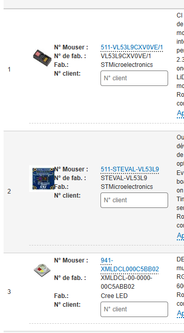

# Projet Harpe Sans Cordes
Objectif du Projet :
## Creer Une harpe
Cette harpe doit être sans cordes, on utiliseras un capteur LIDAR (VL53L9CX) pour jouer les différentes notes.
## Creer Une boule à facette
Cette boule à facette ajoute l'aspect lumière elle seras Wireless. (chaque note à une couleur associée configurable)
## Ajouter de l'"ia"
Nous allons ajouter un écran qui afficheras une Phrase poétique adapter au projet, phrase générée par "IA".
## Différents Systèmes à développer
+ Application Multiplatforme pour configurer les différentes notes ainsi que la couleur associé à la note
+ Programme de la Harpe
+ Programme de la boule à facette
+ Programme de l'écran (poésie "ia")
---
### Application
Le programme est deja là il manque cependant de certaines fonctions pour suporter parfaitement Windows et Linux

---
## Schema du système
```
                  ┌──────────────────────────────────────────────┐
                  │          CAPTEUR TOF VL53L9CX                │
                  │   STEVAL-VL53L9 (Module avec VL53L9CX)       │
                  └──────────────────────┬───────────────────────┘
                                         │ Bus I²C (3.3V)
                                         ▼
┌─────────────────────────────────────────────────────────────────────────────────┐
│                          ARDUINO UNO R4 WIFI N°1 (MAÎTRE)                       │
│ - Analyse les distances du capteur ToF (RAM 32 Ko)                              │
│ - Détermine quelle corde virtuelle est coupée                                   │
│ - Émetteur ESP-NOW (Transmet l'ID de la corde et sa couleur associée)           │
│ - Son                                                                           │
└────────────────────────┬────────────────────────────────────────┬───────────────┘
                         │                                        │
           Trame ESP-NOW │ (Sans fil)               Trame ESP-NOW │ (Sans fil)
                         ▼                                        ▼
┌────────────────────────────────────────┐    ┌───────────────────────────────────┐
│     ARDUINO UNO R4 WIFI N°2 (BOULE)    │    │   ARDUINO UNO R4 WIFI N°3 (Poésie)│
│ - Récepteur ESP-NOW                    │    │ - Récepteur ESP-NOW               │
│ - Pilotage Moteur (Rotation)           │    │ -                                 │
│ - Pilotage Projecteur LED (Couleur)    │    │ -                                 │
└───────────────────┬────────────────────┘    └───────────────────────────────────┘
                    │
                    ├─────────────────────────────────────────┐
                    ▼                                         ▼
   ┌─────────────────────────────────┐       ┌──────────────────────────────────┐
   │    PROJECTEUR LED HIGH-POWER    │       │     ROTEUR BOULE À FACETTES      │
   │ - 1x XMLDCL-00-0000-00C5ABB02   │       │ - Moteur pas-à-pas 28BYJ-48      │
   │ - 3x MOSFETs N-Channel + Res.   │       │ - Driver de puissance ULN2003    │
   │ - Lentille collimatrice 15°-30° │       └──────────────────────────────────┘
   │ - Dissipateur thermique + Pâte  │
   └─────────────────────────────────┘
```
